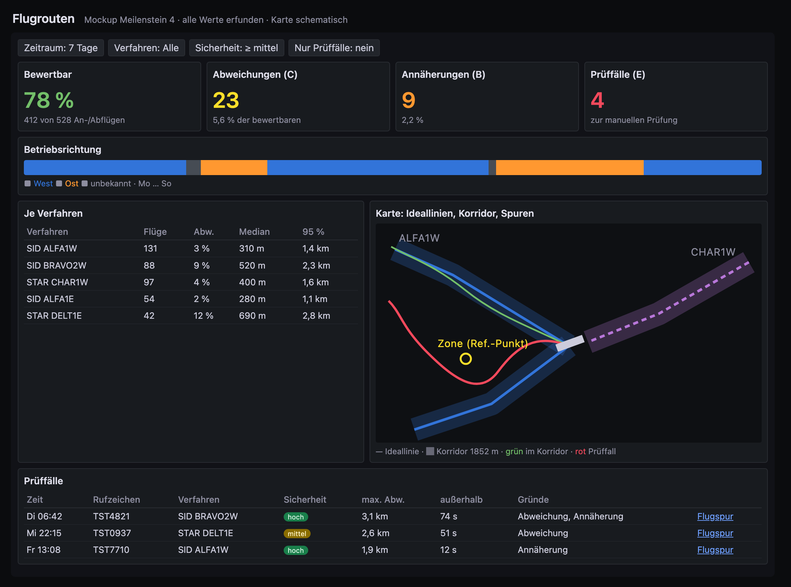

# Meilenstein 4 – Flugroutenvergleich: Design

**Stand:** 2026-11-11 · **Status:** abgestimmt, zur Durchsicht

Grundlage: [architecture.md](../../architecture.md), [analysis.md](../../analysis.md), Design [Meilenstein 3](2026-11-10-meilenstein-3-geofences-dashboard-design.md).

## 1. Ziel und Umfang

Veröffentlichte Abflug- und Anflugverfahren (SID/STAR) als Referenz einbinden, Flüge methodisch nachvollziehbar einem Verfahren zuordnen und Abweichungen bewerten. Ergebnis: eine nachvollziehbare Bewertung auffälliger Flugspuren mit ausgewiesener Zuordnungssicherheit und Datenqualität.

**Im Umfang:**

- Verfahren aus einer lokalen YAML-Datei (von Hand aus der DFS-AIP übertragen), versioniert in der Datenbank
- Rolle eines Flugs (Abflug/Anflug) bezogen auf BER, Betriebsrichtung je 30-Minuten-Fenster
- Zuordnung Flug → Verfahren mit Sicherheitsstufe und Begründung
- Kategorien **C** (Abweichung von der Referenzroute), **B** (auffällige Annäherung an einen Zonen-Referenzpunkt) und **E** (prüfungswürdiger Einzelfall)
- Erweiterung des Dienstes `analysis`, Migration `003_routen.sql`, Dashboard „Flugrouten“, Ergänzung „Flugspur“
- Prüfwerkzeug für die Verfahrensdatei, Tests, E2E, Doku, ADR 0007

**Nicht im Umfang:** Kategorie D (auffällige Flugführung, Direktfreigaben); empirische Korridore und Korridorveränderungen; automatischer Abruf von AIP- oder STANLY-Track-Daten; Berichte, Benachrichtigungen, n8n (M5).

**Grundsätze:** Eine Abweichung ist **kein** Verstoß. Radarführung und individuelle Freigaben sind zulässig und aus ADS-B nicht erkennbar. Eine statistisch typische Spur ist kein veröffentlichtes Verfahren. Jede Bewertung nennt Zuordnungssicherheit, Begründung und Datenqualität.

## 2. Getroffene Entscheidungen

| Frage | Entscheidung |
|---|---|
| Referenzquelle | Offizielle Verfahren aus der DFS-AIP, von Hand in eine lokale Datei übertragen; kein automatischer Abruf |
| Kategorien in M4 | C, B, E; D später |
| Zuordnung | Erst Betriebsrichtung je Zeitfenster, dann Kandidaten nach Rolle, Richtung und Sektor, dann Geometrie; Sicherheitsstufe mit Begründung |
| Abweichungsmaß | Korridor mit halber Breite (Standard 1852 m) und Mindestdauer außerhalb (Standard 30 s) |
| Dateiformat | YAML: Wegpunktliste, Startbahnschwellen, Verfahren als Wegpunktfolge |
| Architektur | Zusätzlicher Schritt im bestehenden Dienst `analysis` (gleiches Wasserzeichen, gleiche Neuberechnung) |

## 3. Verfahrensdatei

Ort: `config/local/procedures.yaml` (gitignored, Inhalte der AIP unterliegen dem Urheberrecht der DFS). Im Repo: `config/procedures.example.yaml` mit erfundenem Flughafen und erfundenen Verfahren im Atlantik.

```yaml
source: "DFS AIP Germany, AD 2 EDDB, AIRAC 2611"   # frei, erscheint in procedures.source
waypoints:
  ABCDE: "45 30 00.00N 030 30 00.00W"   # Grad Minuten Sekunden wie in der AIP
  FGHIJ: [45.4, -29.9]                   # alternativ Dezimalgrad lat, lon
runways:
  "25R": "45 00 00.00N 030 00 00.00W"   # Schwelle, von der aus abgeflogen bzw. auf die angeflogen wird
  "07L": "45 01 00.00N 030 03 00.00W"
procedures:
  - name: ABCDE1W
    kind: SID                # SID oder STAR
    runway: "25R"
    valid_from: 2026-11-05   # AIRAC-Beginn
    valid_to: null           # offen
    airac: "2611"
    route: [ABCDE, FGHIJ]    # Wegpunktfolge; bei SID beginnt die Linie an der Schwelle der Gegenrichtung
    constraints:             # optional, nur zur Anzeige
      ABCDE: {alt_ft_min: 5000, speed_kt_max: 250}
```

(Alle Werte im Beispiel sind erfunden und liegen im Atlantik.)

**Geometrie:**

- SID: Linie von der Schwelle am Abflugende der Startbahn (Schwelle der Gegenrichtung, z. B. für 25R die Schwelle 07L) über die Wegpunkte.
- STAR: Linie über die Wegpunkte, ohne Endanflug.
- Betriebsrichtung eines Verfahrens: aus dem Kurs der Startbahn (Schwelle → Gegenschwelle) in die Klasse `west` (Kurs 180–359°) oder `east` (0–179°).
- Sektor (`N`, `NO`, …, wie in M3): Richtung vom BER-Referenzpunkt zum Punkt, an dem die Linie den BER-Radius verlässt (SID) bzw. betritt (STAR); liegt die Linie ganz innerhalb, der letzte bzw. erste Wegpunkt.

**Prüfung (Datei wird als Ganzes abgelehnt, alte Fassung bleibt aktiv):** unbekannter Wegpunkt oder Startbahn; Koordinate unlesbar oder außerhalb ±90/±180; Wegpunkt weiter als 200 km vom BER-Referenzpunkt; doppelter Wegpunkt- oder Verfahrensname innerhalb überlappender Gültigkeit; Route mit weniger als einem Wegpunkt; `valid_to` vor `valid_from`. Meldungen nennen Eintrag und Feld, nie Koordinaten.

## 4. Datenmodell (Migration `003_routen.sql`)

### 4.1 `procedures`

`id`, `name`, `kind` (`SID`/`STAR`), `runway`, `direction` (`west`/`east`), `sector`, `airac`, `valid_from date`, `valid_to date NULL`, `source`, `geom geometry(LineString, 4326)`, `waypoints jsonb` (Namen in Reihenfolge), `constraints jsonb`, `content_hash`, `loaded_at`, `superseded_at NULL`.

Versionierung wie bei `geofences`: Ändert sich der Inhalt eines Verfahrens (gleicher `name`, gleicher `valid_from`), wird die bisherige Zeile mit `superseded_at` geschlossen und eine neue angelegt. Für einen Flug gilt die nicht abgelöste Fassung, deren `[valid_from, valid_to)` den Flugbeginn (Datum UTC) enthält.

### 4.2 `operating_directions`

`window_start timestamptz` (PK, auf 30 Minuten ausgerichtet), `direction` (`west`/`east`/`unknown`), `n_flights`, `share` (Anteil der Mehrheit), `basis text`, `run_id`.

### 4.3 `flight_assessments`

| Spalte | Bedeutung |
|---|---|
| `flight_id` | PK, FK auf `flights` mit `ON DELETE CASCADE` |
| `run_id` | erzeugender Lauf |
| `role` | `departure`/`arrival` |
| `direction` | Betriebsrichtung des Fensters zum Bezugszeitpunkt |
| `flight_sector` | Sektor, in dem der Flug den BER-Radius verlässt bzw. betritt |
| `procedure_id` | zugeordnetes Verfahren, NULL wenn keines |
| `confidence` | `high`/`medium`/`low`/`none` |
| `basis` | Begründung (Text, je Prüfung ein Satz) |
| `mean_dev_m`, `second_mean_dev_m` | mittlere Abweichung bestes und zweitbestes Verfahren |
| `eval_from`, `eval_to` | bewerteter Abschnitt (NULL ohne Bewertung) |
| `max_dev_m`, `outside_s`, `outside_m` | größte Abweichung, Dauer und Strecke außerhalb des Korridors |
| `deviation` | Kategorie C |
| `ref_geofence_id` | Zonenfassung, deren Referenzpunkt für B maßgeblich ist |
| `min_dist_ref_m`, `proc_dist_ref_m` | kleinster Abstand Flug bzw. Ideallinie zu diesem Referenzpunkt |
| `approach` | Kategorie B |
| `review`, `review_reasons text[]` | Kategorie E und erfüllte Bedingungen |
| `in_reception_gap`, `max_position_gap_s` | Datenqualität im bewerteten Abschnitt |

Nur Flüge mit Rolle `departure`/`arrival` erhalten eine Zeile.

### 4.4 Views und Rechte

- `route_stats_daily`: je Tag (Europe/Berlin), Verfahren und Sicherheitsstufe Anzahl, Abweichungen, Annäherungen, Prüffälle, Median und 95-%-Wert von `max_dev_m`.
- `flightdb_analysis`: SELECT/INSERT/UPDATE/DELETE auf die neuen Tabellen; `flightdb_reader`: SELECT auf Tabellen und View.
- `analysis_runs.params` enthält zusätzlich alle Parameter aus 5.7.

## 5. Ablauf im Dienst `analysis`

Neue Module: `procedures.py` (Datei lesen, prüfen, Geometrie, Abgleich), `role.py` (Rolle), `direction.py` (Betriebsrichtung), `assign.py` (Zuordnung), `deviation.py` (Korridor, Annäherung, Prüffall), `routes.py` (Ablauf und DB-Zugriffe dieses Schritts). Rechnung in Python auf einer lokalen abstandstreuen Projektion um den BER-Referenzpunkt (Fehler im Umkreis 100 km vernachlässigbar gegenüber der Korridorbreite). `analysis.__version__` steigt auf 0.3.0.

Der Schritt läuft im selben Lauf und in derselben Transaktion nach den Überflugereignissen, je Flug mit Savepoint wie bisher.

### 5.1 Verfahren abgleichen

Mit dem Zonenabgleich zu Beginn des Laufs. Fehlt `ANALYSIS_PROCEDURES_FILE` oder die Datei, wird der Routenschritt übersprungen und je Lauf eine Warnung protokolliert; Flüge und Überflüge entstehen weiter, `health` bleibt grün. Ist die Datei ungültig, bleibt die bisherige Fassung aktiv und der Fehler wird protokolliert.

### 5.2 Rolle

Betrachtet wird der Teil des Flugs innerhalb `ANALYSIS_BER_RADIUS_M`.

- `departure`: Der Teil beginnt innerhalb `ANALYSIS_ROLE_NEAR_M` (Standard 10000) um den BER-Referenzpunkt unterhalb `ANALYSIS_ROLE_MAX_ALT_FT` (Standard 3000), und die mittlere Vertikalrate des Teils ist > +`ANALYSIS_VRATE_FPM`.
- `arrival`: spiegelbildlich am Ende des Teils mit Sinken.
- sonst keine Rolle, keine Bewertung.

### 5.3 Betriebsrichtung

Je Flug mit Rolle der Bezugskurs: Kurs zwischen den Positionen im Abstand `ANALYSIS_DIRECTION_DIST_M` (Standard 15000) bis zum Rand von `ANALYSIS_ROLE_NEAR_M` – bei Abflügen die ersten, bei Anflügen die letzten. Bezugszeitpunkt: Startzeit bzw. Landezeit (erste bzw. letzte Position des Teils). Klasse `west`/`east` nach demselben Schema wie bei Verfahren, wenn der Kurs höchstens `ANALYSIS_DIRECTION_TOL_DEG` (Standard 30) vom Startbahnkurs abweicht, sonst ohne Stimme.

Je 30-Minuten-Fenster: Mehrheit, wenn mindestens `ANALYSIS_DIRECTION_MIN_FLIGHTS` (Standard 3) Stimmen und Anteil ≥ `ANALYSIS_DIRECTION_MIN_SHARE` (Standard 0,8); sonst `unknown`. Neu berechnet werden alle Fenster, in denen der Lauf Flüge gelöscht oder gebildet hat. Die Startbahnkurse stammen aus den Startbahnen der Verfahrensdatei.

### 5.4 Zuordnung

1. Kandidaten: gültige Verfahren mit passender Art (SID ↔ `departure`, STAR ↔ `arrival`) und – wenn bekannt – passender Betriebsrichtung.
2. Sektor: Kandidat mit gleichem Sektor wie der Flug „passt genau“, Nachbarsektor „passt ungefähr“, sonst ausgeschlossen.
3. Geometrie: mittlerer seitlicher Abstand der Flugpositionen im Geltungsabschnitt (5.5) zur Ideallinie; das Minimum gewinnt.
4. Sicherheitsstufe:
   - `high`: Richtung bekannt, Sektor genau, `second_mean_dev_m ≥ ANALYSIS_ASSIGN_RATIO × mean_dev_m` (Standard 2,0) oder kein Zweitkandidat.
   - `medium`: genau eine dieser drei Bedingungen nicht erfüllt.
   - `low`: mehrere nicht erfüllt.
   - `none`: kein Kandidat.

### 5.5 Abweichung (C)

Geltungsabschnitt: Positionen, deren Projektion auf die Ideallinie zwischen Anfang und Ende der Linie liegt; zusätzlich, wenn `ANALYSIS_ROUTE_MAX_ALT_FT` gesetzt ist (kein Standardwert), nur Positionen bis zu dieser Höhe. Bewertet wird nur bei Sicherheit `high` oder `medium`.

Korridor: halbe Breite `ANALYSIS_CORRIDOR_M` (Standard 1852). Außerhalb-Abschnitte werden aus aufeinanderfolgenden Positionen gebildet (Zeitpunkte des Ein- und Austritts linear interpoliert). `deviation = true`, wenn mindestens ein Abschnitt `ANALYSIS_CORRIDOR_MIN_S` (Standard 30) dauert. `max_dev_m`, `outside_s` (Summe), `outside_m` (Summe der Strecke) über den Geltungsabschnitt.

### 5.6 Annäherung (B) und Prüffall (E)

B: Für jede aktuelle Zone den kleinsten Abstand des Flugs zum Zonen-Referenzpunkt (`min_dist_ref_m`) und der Ideallinie zum selben Punkt (`proc_dist_ref_m`). Maßgeblich ist die Zone mit der kleinsten Differenz `min_dist_ref_m − proc_dist_ref_m`. `approach = true`, wenn diese Differenz kleiner als `−ANALYSIS_APPROACH_TOL_M` ist (Standard = `ANALYSIS_CORRIDOR_M`). Nur bei Sicherheit `high` oder `medium`.

E: `review = true`, wenn alle gelten (Gründe werden in `review_reasons` aufgeführt):

- `deviation` oder `approach`
- Sicherheit `high` oder `medium`
- keine Empfangslücke im bewerteten Abschnitt und `max_position_gap_s ≤ ANALYSIS_REVIEW_MAX_GAP_S` (Standard 30)
- mindestens ein Überflugereignis des Flugs mit `relevant = true`

### 5.7 Parameter

`ANALYSIS_PROCEDURES_FILE`, `ANALYSIS_ROLE_NEAR_M` (10000), `ANALYSIS_ROLE_MAX_ALT_FT` (3000), `ANALYSIS_DIRECTION_DIST_M` (15000), `ANALYSIS_DIRECTION_TOL_DEG` (30), `ANALYSIS_DIRECTION_MIN_FLIGHTS` (3), `ANALYSIS_DIRECTION_MIN_SHARE` (0.8), `ANALYSIS_ASSIGN_RATIO` (2.0), `ANALYSIS_ROUTE_MAX_ALT_FT` (leer), `ANALYSIS_CORRIDOR_M` (1852), `ANALYSIS_CORRIDOR_MIN_S` (30), `ANALYSIS_APPROACH_TOL_M` (= Korridor), `ANALYSIS_REVIEW_MAX_GAP_S` (30). Alle werden in `nas/docker-compose.yml` durchgereicht; ein Test sichert die Übereinstimmung der Standardwerte.

### 5.8 Befehle

`python -m analysis procedures [datei]` lädt die Verfahren sofort. `scripts/check_procedures.py datei` prüft offline und gibt je Verfahren Name, Art, Startbahn, Richtung, Sektor, Gültigkeit und Länge aus – keine Koordinaten.

## 6. Grafana



*Mockup, abgestimmte Variante „Kennzahlen zuerst“. Alle Werte, Verfahrens- und Rufzeichen sind erfunden.*

**Dashboard „Flugrouten“** (Generator wie in M3):

- Kennzahlen: Anteil bewertbarer Flüge (Sicherheit ≥ mittel), Abweichungen, Annäherungen, Prüffälle im Zeitraum
- Betriebsrichtung über die Zeit (Zustandsband west/east/unknown)
- Tabelle je Verfahren: Flüge, Anteil Abweichung, Median und 95-%-Wert `max_dev_m`
- Tabelle „Prüffälle“: Zeit, Rufzeichen, Verfahren, Sicherheit, `max_dev_m`, Gründe; Link auf „Flugspur“
- Karte: gültige Ideallinien, Korridor als Fläche (`ST_Buffer` auf `geography`), Spuren der gewählten Flüge; Ansicht `fit`

**„Flugspur“:** zusätzlich zugeordnetes Verfahren mit Ideallinie und Korridor sowie die Bewertung.

## 7. Datenschutz und Urheberrecht

Echte Verfahren nur in `config/local/procedures.yaml`. Im Repo nur das Atlantik-Beispiel. Logs und Prüfausgaben ohne Koordinaten. Dashboards ohne Kartenmittelpunkt; `check_dashboards.py` bleibt in der CI. Die Doku weist auf die Urheberschaft der DFS an AIP-Inhalten hin.

## 8. Tests

Nur synthetische Daten: erfundener Flughafen mit zwei Startbahnrichtungen und je zwei SIDs/STARs im Atlantik bzw. um 50° N / 10° O.

- Rein: Datei lesen (Grad/Minuten/Sekunden, Dezimalgrad), alle Ablehnungsgründe, Geometrie und Sektor, Rolle, Betriebsrichtung (klare Mehrheit, knappe Mehrheit, zu wenige Flüge, Kurs außerhalb der Toleranz), Zuordnung und alle Sicherheitsstufen, Korridor (Mindestdauer, kurzer Überschwinger, Höhengrenze, Geltungsabschnitt), Annäherung, Prüffall-Regel.
- Datenbank: Versionierung und Ablösung, Gültigkeit zur Flugzeit, Kaskade beim Löschen von Flügen, Nachlieferung ändert Betriebsrichtung und Bewertung, `rebuild` reproduziert identische Bewertungen, alle Dashboard-Abfragen als Leserolle.
- E2E: Attrappe fliegt synthetische An- und Abflüge auf erfundenen Verfahren; erwartet: Betriebsrichtung erkannt, Zuordnungen `high`, genau ein Prüffall.

## 9. Doku

`docs/routes.md` (Übertragen aus der AIP: welche Angaben aus welchem Teil; Methodik; Grenzen; Urheberrecht), ADR 0007 (Zuordnungsmethode), Ergänzungen in `analysis.md`, `data-model.md`, `dashboard.md`, `deployment-nas.md`, README-Status.

## 10. Abnahme

Software: alle Tests grün, E2E mit Prüffall, Doku vollständig. Mit Hardware (nach M2/M3-Abnahme): echte Verfahrensdatei geladen, Betriebsrichtung über mindestens eine Woche plausibel gegenüber öffentlich bekannten Betriebsrichtungswechseln, Stichprobe von zehn Zuordnungen manuell mit Karte geprüft.

## 11. Offene Punkte (blockieren die Entwicklung nicht)

- Wert für `ANALYSIS_ROUTE_MAX_ALT_FT` aus der AIP bzw. aus veröffentlichten Informationen zur Radarführung ableiten.
- Ob der Empfänger An- und Abflüge nahe BER in ausreichender Höhe sieht, zeigt erst die Hardware-Abnahme; ohne Sicht nahe BER fällt die Rolle aus und es entstehen keine Bewertungen.
